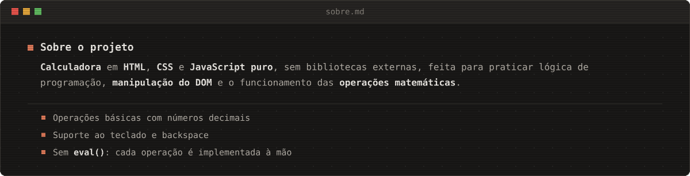
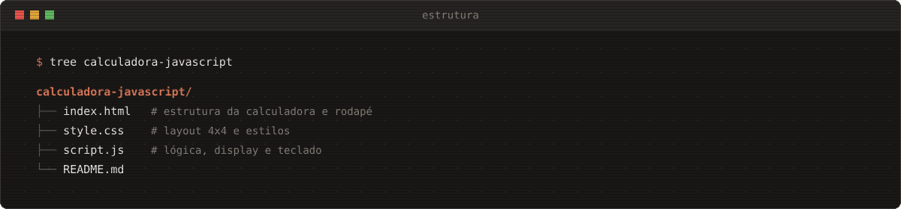

Não precisa instalar nada: é só abrir o `index.html` no navegador.

```bash
git clone https://github.com/GabrielCardossso/calculadora-javascript
cd calculadora-javascript
# abra o arquivo index.html no navegador
```



| Tecla | Ação |
| --- | --- |
| `0`–`9` | Digita o número |
| `.` ou `,` | Ponto decimal |
| `+` `-` `*` `/` | Escolhe a operação |
| `Enter` ou `=` | Mostra o resultado |
| `Backspace` | Apaga o último dígito |
| `Esc` ou `C` | Limpa tudo |

### Limitações atuais

Intencionais, para fins de aprendizado:

- Apenas uma operação por vez (sem operações encadeadas).
- Não aplica precedência matemática.



| Versão | O que mudou |
| --- | --- |
| **V1.0** · Versão inicial | Estrutura básica em HTML, calculadora funcional com operações simples, sem preocupação com estética |
| **V2.0** · Organização do código | Separação de responsabilidades, JavaScript mais bem estruturado e pequenos ajustes de funcionamento |
| **V3.0** · Remoção do `eval()` | Operações implementadas manualmente: mais controle da lógica e código mais seguro e organizado |
| **V4.0** · Decimais, teclado e backspace | Números decimais, teclado, backspace (⌫) e bloqueio de múltiplas operações inválidas, mantendo uma operação por vez |
| **V5.0** · Layout refinado e lançamento | Layout 4x4 reorganizado, botões padronizados, melhorias visuais e de acessibilidade, publicação via GitHub Pages |
| **V5.1** · Rodapé do site | Rodapé com links pessoais (GitHub e Instagram) |



- Manipulação do DOM e eventos do teclado.
- Estruturas condicionais e funções em JavaScript.
- Tratamento de entradas inválidas.
- Organização de código.
- Operações matemáticas e lógica de programação.
- CSS responsivo.

<a href="https://github.com/GabrielCardossso"></a>
